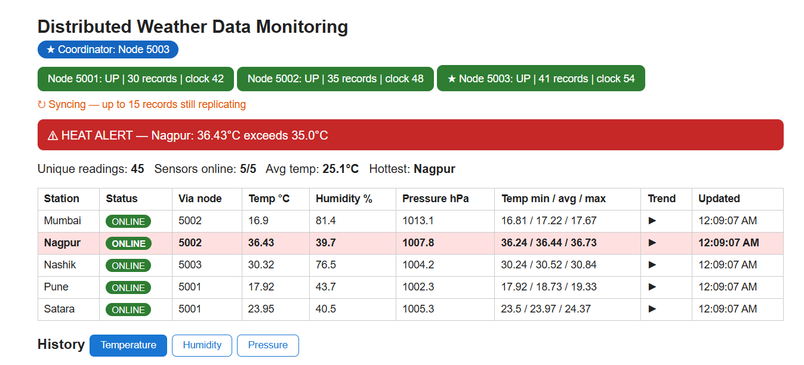
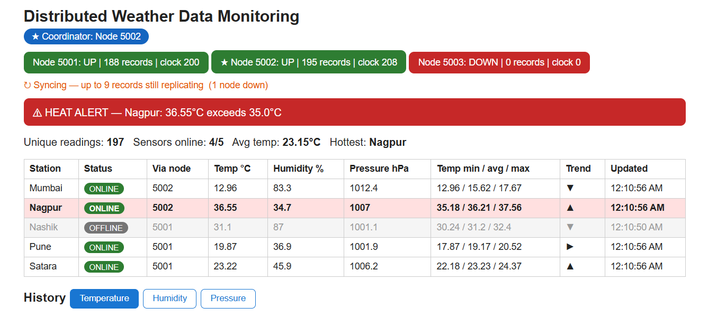
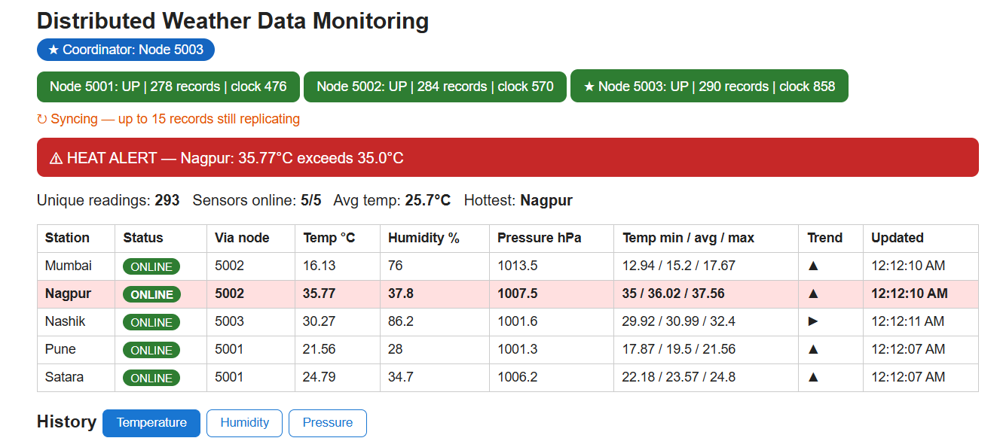
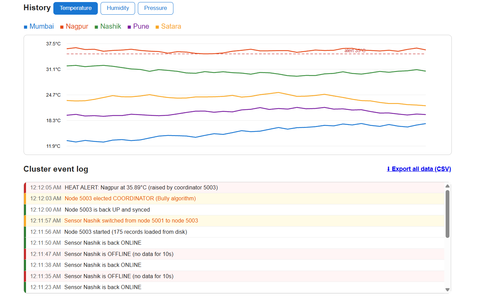

# Distributed Weather Data Monitoring System

A mini project for **Distributed Computing Systems**. Multiple simulated weather sensors send temperature,
humidity and pressure readings to a cluster of storage nodes. The nodes replicate data, detect failures,
elect a coordinator, and a live web dashboard shows the merged view of the whole system.

Pure Python 3 (standard library only) - nothing to install.

## Features

- 5 simulated sensor nodes (temperature, humidity, pressure)
- 3 storage nodes with **data replication** and **eventual consistency**
- **Heartbeat failure detection** and automatic **sensor failover**
- **Anti-entropy sync**: a recovered node pulls the data it missed
- **Leader election (Bully algorithm)**; only the coordinator raises alerts
- **Lamport logical clock** on every record
- **Persistence**: append-only log per node, survives full restarts
- Live dashboard: node health, coordinator, sync status, sensor status, heat alerts,
  min/avg/max + trend, Temperature/Humidity/Pressure charts, event log, CSV export

## Architecture

```
  Sensors (Pune, Mumbai, Nashik, Satara, Nagpur)
        |  HTTP POST /ingest   (home node, failover to next node)
        v
  +-----------+   replicate   +-----------+   replicate   +-----------+
  | Node 5001 | <-----------> | Node 5002 | <-----------> | Node 5003 |
  +-----------+   heartbeat   +-----------+   heartbeat   +-----------+
        ^   (election, event log, sync)  ^                       ^
        +--------------------------------+-----------------------+
                                  |
                           Dashboard :8000
                  (merges + de-duplicates data from all nodes)
```

## Distributed concepts demonstrated

| Concept | Where |
|---|---|
| Replication | `node.py` - every reading is copied to all peers |
| Fault tolerance / failover | `sensor.py` - sensor moves to the next live node |
| Failure detection | `node.py` - heartbeat every 2 seconds |
| Eventual consistency (AP in CAP) | nodes may differ briefly, then converge |
| Leader election (Bully) | `node.py` - highest-ID live node becomes coordinator |
| Logical clocks (Lamport) | `node.py` - `lc` field on every record |
| Idempotent writes | unique key `station:seq`, duplicates ignored |
| Recovery / anti-entropy | `node.py` - pull missing data when a peer returns |
| Persistence | `data/node_<port>.jsonl` |

## How to run

Requires Python 3.8+.

```
python run_all.py --fresh
```

Open **http://localhost:8000**. Type these commands in the same terminal while it runs:

| Command | Effect |
|---|---|
| `kill 5003` | Stop a node (dashboard turns it red; if it is the coordinator, a new election happens) |
| `start 5003` | Restart it (syncs missed data, becomes coordinator again) |
| `kill 5001` | Sensors homed on 5001 fail over to another node |
| `quit` | Stop everything (Ctrl+C also works) |

Other modes: `python run_all.py` (keep saved data), `python run_all.py --chaos` (automatic coordinator failure at 20s, restart at 80s).

Manual mode (separate terminals):

```
python node.py --port 5001 --peers 5002,5003
python node.py --port 5002 --peers 5001,5003
python node.py --port 5003 --peers 5001,5002
python sensor.py --id Pune --home 5001
python dashboard.py
```

## Project structure

```
node.py        storage node: replication, heartbeat, election, event log, persistence
sensor.py      simulated weather station with failover
dashboard.py   web dashboard + CSV export (port 8000)
run_all.py     launcher with live kill/start commands
```

## Screenshots

| Normal operation | Node failure + new coordinator |
|---|---|
|  |  |

| Recovery and sync | Charts and event log |
|---|---|
|  |  |

## Test results

- After a node crash and restart, all nodes held identical data (for example 95 records each).
- When the coordinator (5003) was killed, node 5002 was elected; when 5003 returned it became coordinator again.
- When node 5001 was killed, its sensors switched to node 5002 and switched back after recovery.
- After stopping the whole system and starting again, every node recovered its records from disk.

## Limitations and future work

- All nodes run on one machine (localhost); sensors are simulated
- Event log is kept in memory only
- No authentication or encryption (plain HTTP)
- Possible extensions: consistent hashing, Docker Compose, real weather API, quorum reads/writes
